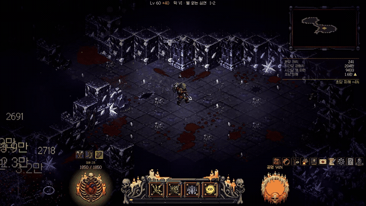
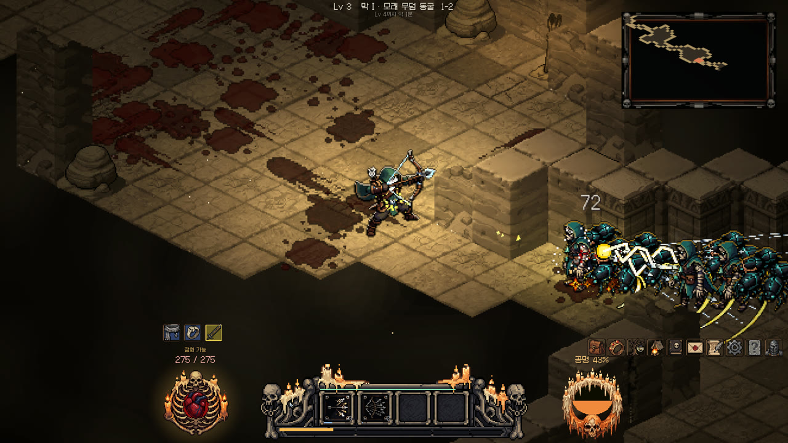
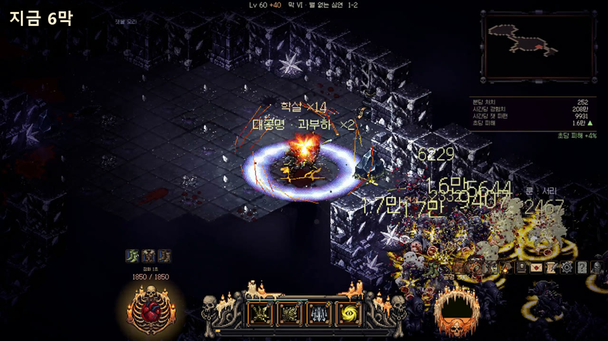
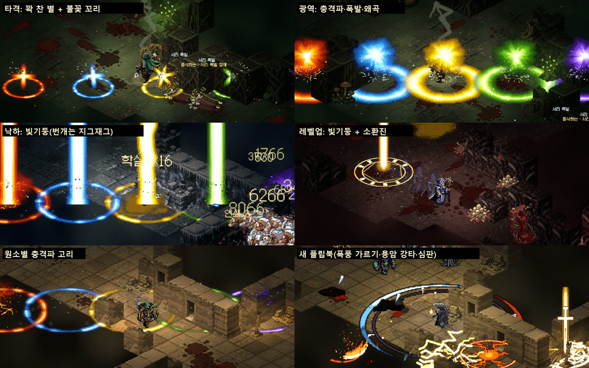

# 등불지기 (Lanternkeeper)

**알아서 사냥하는 디아블로라이크.** 바탕화면 한쪽에 띄워 두면 영웅이 스스로 던전을 탐험하고 몬스터를 쓸어 담는 2.5D 아이소메트릭 도트 Idle ARPG입니다. 플레이어는 직접 싸우지 않고 스킬 고리 배치, 장비, 룬, 환생 선택으로 빌드를 만듭니다.

- 엔진: **Unity 6 (6000.6.9f1), URP 2D**, C#
- 개발: 1인 개발. 2026-11 시작, 진행 중인 프로토타입
- 규모: 게임 코드 약 21,700줄, 테스트 약 4,200줄(EditMode 테스트 318개)



| 1막 · 모래 무덤 동굴 | 6막 · 별 없는 심연 (후반) |
|---|---|
|  |  |



---

## 게임 소개

- **4직업**: 잿불기사·서약기사(근접), 바람사냥꾼·별점술사(원거리). 직업마다 성장 축이 다릅니다. 근접은 공속·이속으로 무리 사이를 휩쓸고, 원거리는 범위·사거리로 스킬을 키웁니다.
- **6막 던전**: 모래 → 수풀 → 핏덩이 → 얼음 → 용암 → 심연. 막마다 몬스터 6종, 정예, 보스가 있고, 층은 절차 생성합니다.
- **스킬 고리와 원소 공명**: 스킬이 고리 순서대로 돌아갑니다. 원소 표식이 겹치면 공명(과부하·연쇄 폭발 등)이 터지고, 처치가 다시 처치를 부르는 연쇄로 이어집니다.
- **성장할수록 화면이 커진다**: 스킬 숙련 10레벨마다 분신이 하나씩 늘어 같은 스킬이 다른 무리에도 복제되고, 후반에는 이펙트가 맵을 채웁니다.
- **파밍**: 등급·대옵션(★)·룬워드·제작과 직업 맞춤 루트 필터, 오프라인 진행 정산, 환생 증강 카드, 업적과 도감.

## 기술 포인트

### 1. 결정론적 시뮬레이션과 뷰 분리
- `Assets/_Game/Sim`(37개 파일)은 **UnityEngine을 참조하지 않는 순수 C#**입니다. 자체 `Vec2`, 시드 RNG(`SimRng`), 고정 틱(`SimClock`)으로 돌아갑니다.
- 게임 상태는 시뮬레이션이 소유합니다. 뷰(`Assets/_Game/View`)는 틱마다 나오는 `SimEvent` 목록만 읽어 렌더링, 이펙트, 사운드, UI를 그립니다.
- 같은 시드와 입력이면 같은 결과가 나옵니다. `SimDeterminismTests`가 수천 틱을 돌린 뒤 상태 해시를 **골든 값**과 비교해서, 화면 쪽 작업이 게임 로직을 몰래 바꾸지 못하게 막습니다.
- 그래서 밸런스는 헤드리스로 확인합니다. 20~60시간 플레이를 시뮬레이션해 직업별 막 도달 시간을 측정하고, 곡선을 조정했습니다.

### 2. 픽셀 아트용 렌더링
- 월드를 정수 배율 렌더 텍스처에 그린 뒤 화면에 올립니다(`WorldPresenter`). 해상도가 바뀌어도 픽셀이 고르게 유지됩니다.
- 2D 라이트, 유닛 테두리와 림 라이트, 시체 디졸브는 `ActorSprite` 셰이더가 처리합니다. 폭발 같은 이펙트 광원이 주변 유닛의 윤곽을 그 색으로 물들입니다.

### 3. 픽셀 VFX 파이프라인
도트 오브젝트 위에 올라가는 이펙트가 밋밋해 보이는 문제를 풀기 위해, 픽셀 게임들의 VFX 접근법을 리서치하고([docs/research/1123_pixel_vfx.md](docs/research/1123_pixel_vfx.md)) 여러 층을 직접 만들었습니다.
- **`PixelFx` 셰이더**: 충격파, 베기 잔상, 타격 별, 폭발, 그을음, 빛기둥, 마법진, 위험 장판을 **아트 픽셀 격자**에 맞춰 수식으로 그립니다. 원소별 5톤 램프와 가장자리 Bayer 디더를 쓰고, 백열 코어만 HDR로 블룸을 받습니다.
- **픽셀 파티클**: 꼬리 있는 불꽃, 불씨, 바닥에 튀는 파편, 서리 조각, 연기, 번개를 두 장의 메시로 한 번에 그립니다(최대 4,000개). 파편·피·불꽃은 **타격 방향**(영웅, 폭발 중심, 화살 출발점에서 대상 쪽)으로 흩어집니다.
- **화면 반응**: 렌더 텍스처를 화면에 올리는 단계에서 충격파가 바닥을 굽히는 왜곡(아트 픽셀 단위), 궁극기·보스 처치 때 2~3프레임 두 톤 임팩트 프레임, 줌 펀치를 줍니다.
- **플립북**: 생성한 시트 119개를 임포터(`Editor/ArtImporter.cs`)가 레이어(behind/front)와 시작 프레임까지 읽어 `SpriteCatalog`로 묶습니다. 원소가 바뀐 스킬은 같은 시트를 5톤 램프 셰이더로 다시 칠합니다.
- **연출 감독(`VfxDirector`)**: 타격 무게(평타·마무리·궁극)에 맞춰 층을 쌓고, 틱마다 예산을 둬서 후반 대규모 전투에서도 화면이 읽히고 프레임이 유지되게 합니다.
- **Aseprite CLI 후처리**: `tools/aseprite/vfx_post.lua`로 시트를 무료로 일괄 처리합니다(원소 램프 재매핑, 1px 외곽선, 정수 확대).

### 4. 그 밖에
- A* 경로 탐색과 전투 사이 이동 배속, 아이소메트릭 정렬과 안개(등불 반경)
- 오프라인 진행 정산, 저장 데이터 이주, 설정(흔들림·번쩍임·효과 강도·피해 숫자 단계)
- 디아블로풍 HUD(체력 구, 공명 게이지 컵 마스크), 사냥 성과 패널, 전설 획득 배너

## 개발 방식
- **AI 협업**: 코딩, 리서치, 리뷰를 AI 코딩 에이전트(Claude Code)와 페어로 진행했습니다. 기획 결정, 방향 설정, 결과 검증은 제가 했습니다. 큰 변경은 1080p 빌드 녹화와 블라인드 비평으로 확인했습니다.
- **아트**: 캐릭터, 타일, UI, VFX 도트는 PixelLab으로 생성한 뒤 직접 다듬었습니다. 폰트는 [Galmuri](https://github.com/quiple/galmuri)(SIL OFL)를 씁니다. 바닥 충격파 시트는 [PVFX Foundry](https://nerijs.itch.io/pvfx-foundry)(nerijs, CC0)를 `tools/pvfx/pvfx_to_pack.py`로 변환해 원소별로 씁니다.
- **테스트 우선**: 시뮬레이션 기능은 EditMode 테스트와 함께 추가했습니다(318개).

## 폴더 구조
```
IdleARPG/                     Unity 프로젝트
  Assets/_Game/Sim/           순수 C# 게임 로직 (결정론, Unity 비의존)
  Assets/_Game/View/          렌더링·VFX·UI·오디오 (SimEvent 구독)
  Assets/_Game/Resources/     셰이더 (PixelFx, PixelParticle, WorldPresent, ActorSprite …), 폰트
  Assets/_Game/Tests/         EditMode 테스트
  Assets/_Game/Editor/        아트 임포터, 씬 빌더
  Assets/_Game/Art/PixelLab/  도트 에셋
docs/research/                렌더링·VFX·타격감 리서치 노트
docs/specs/                   일부 설계 문서
tools/aseprite/               Aseprite Lua 후처리 스크립트
```

## 실행
1. Unity **6000.6.9f1**로 `IdleARPG/` 폴더를 엽니다.
2. `Assets/_Game/Scenes/Diorama.unity`를 열고 Play를 누릅니다.
3. 테스트는 Window → General → Test Runner → EditMode에서 실행합니다.

> 이 저장소는 포트폴리오용 공개 스냅샷입니다. 개발 기록과 내부 문서는 비공개 저장소에서 관리합니다.
